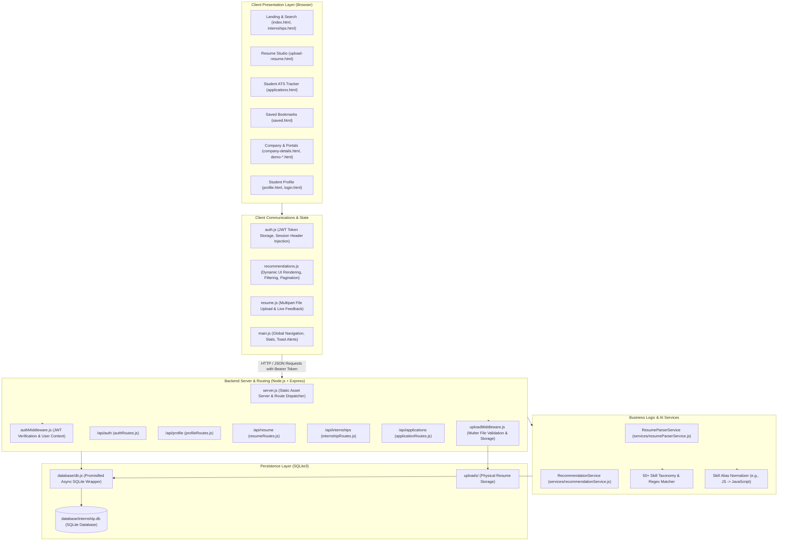
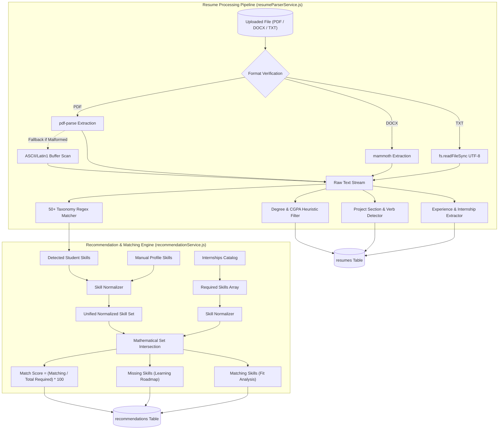
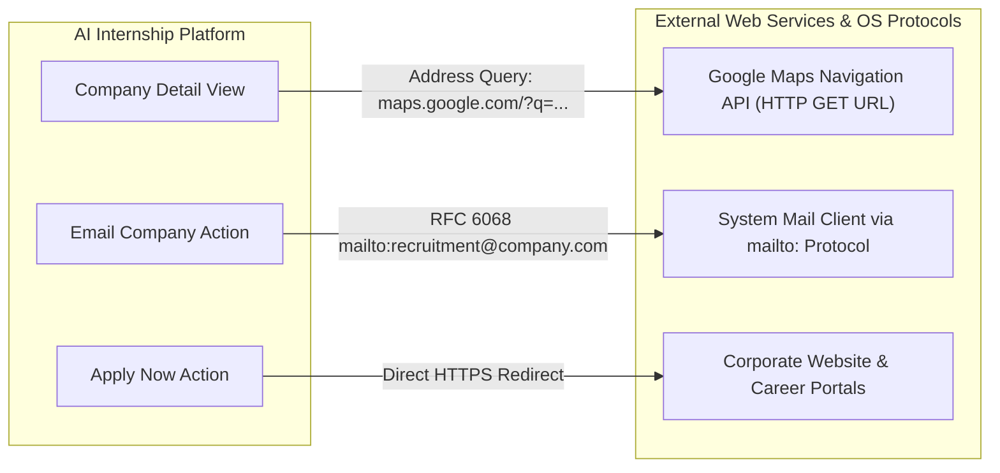
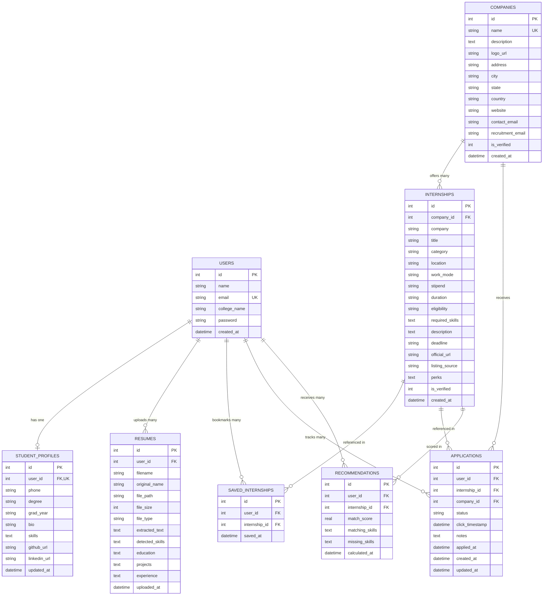
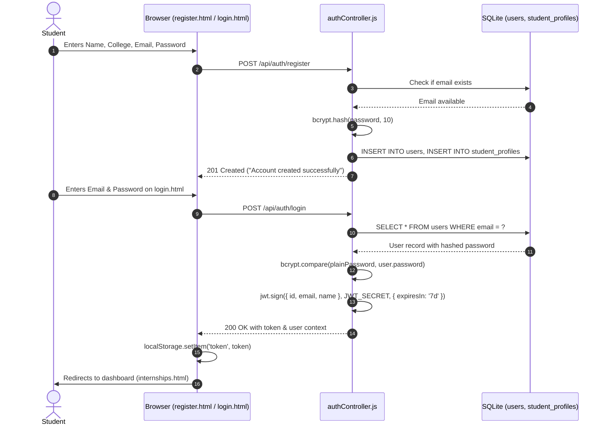
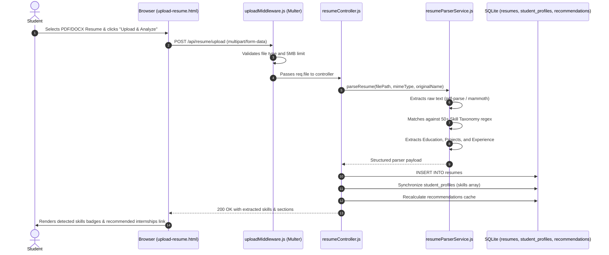
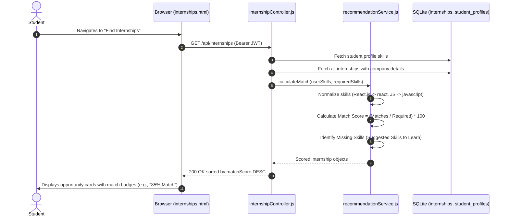
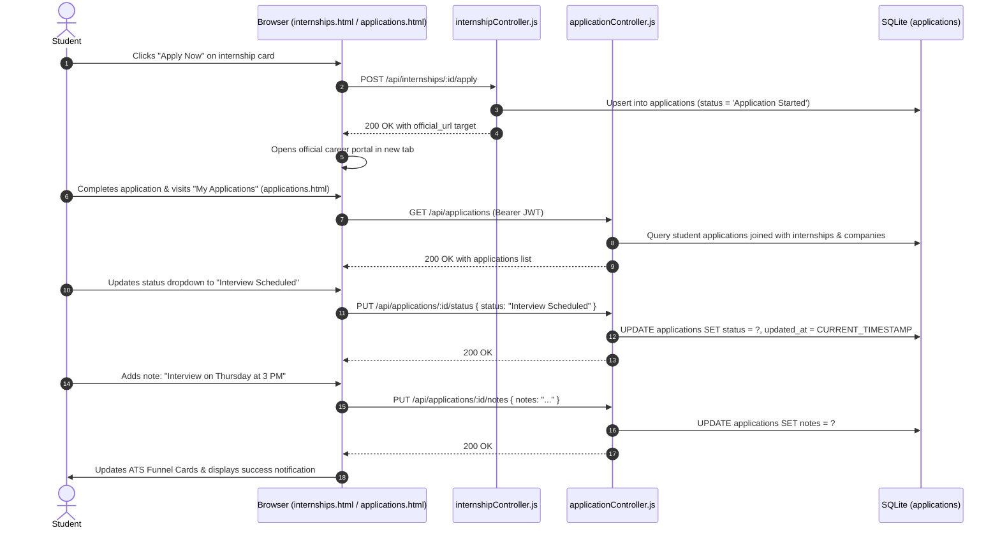
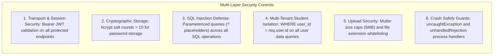

# AI Internship Aggregator and Recommendation Platform
## Comprehensive Technical Documentation & Architecture Reference

---

## 1. Executive Summary & Project Overview

The **AI Internship Aggregator and Recommendation Platform** is an end-to-end, full-stack web application designed to connect college students with curated, verified, and personalized internship opportunities. The platform addresses common challenges faced by students entering the workforce: fragmented internship listings, lack of transparent skill matching, inefficient resume screening, and poor application status tracking.

### Core Value Propositions
- **Elimination of Heavy Server Stacks:** Unlike conventional legacy PHP/Apache/XAMPP academic stacks, this project runs on an ultra-lightweight, high-performance **Node.js + Express.js** runtime paired with an embedded **SQLite3** database (`database/internship.db`). It requires no background database daemons, external database configuration, or paid hosting tiers.
- **Rule-Based NLP & Skill Matching Engine:** Embedded artificial intelligence and natural language processing techniques extract structured skills, educational qualifications, projects, and work experience from student resumes (PDF, DOCX, TXT) and calculate a deterministic, transparent skill-match score against live industry requirements.
- **Official Company Redirection & Deep Integration:** Every listing maps directly to verified corporate profiles, official company websites, recruitment email desks, and real-world career application portals.
- **Full-Featured Student ATS (Application Tracking System):** A personal application tracker that captures application journeys across 8 lifecycle stages (`Interested`, `Application Started`, `Applied`, `Assessment`, `Interview Scheduled`, `Offer Received`, `Rejected`, `Withdrawn`) along with private notes and real-time KPI metrics.
- **Strict Data Isolation & Multi-Tenancy:** Each student's applications, bookmarks, profile information, and uploaded resumes are strictly isolated and protected via cryptographic JSON Web Tokens (JWT) and parameterized SQL queries.

---

## 2. System Architecture & High-Level Design

The application follows a modular, tiered **Model-View-Controller (MVC) / Service-Repository** architecture adapted for Node.js and Express.js.

### High-Level Architecture Diagram



### Component Tiers
1. **Presentation Layer (`public/`):** Built with HTML5, CSS3, modern Vanilla JavaScript (ES6+), and Bootstrap 5. It uses client-side rendering for data-driven views, dynamic modals for email and notes, and responsive cards for listings.
2. **Controller Layer (`controllers/`):** Handles incoming HTTP requests, validates request payloads, enforces business logic, delegates to specialized services, and constructs standard JSON responses.
3. **Middleware Layer (`middleware/`):** Intercepts requests for authentication (`authMiddleware.js`) and handles multipart/form-data file uploads (`uploadMiddleware.js`).
4. **Service Layer (`services/`):** Contains pure business logic decoupled from HTTP concerns. Houses the NLP parser (`resumeParserService.js`) and matching algorithm (`recommendationService.js`).
5. **Database Layer (`database/`):** Centralized Promisified SQLite wrapper (`db.js`) providing `db.get()`, `db.all()`, `db.run()`, and `db.exec()` for async/await execution, along with automated safe migrations (`initDb.js`).

---

## 3. Directory & File Structure

```
AI_Internship_Platform/
├── .env.example                     # Environment variable template for deployments
├── .gitignore                       # Git exclusion rules (node_modules, uploads, .env)
├── package.json                     # Project manifest, dependencies, and execution scripts
├── package-lock.json                # Deterministic dependency lockfile
├── server.js                        # HTTP server entry point, middleware & route registration
├── start_server.bat                 # One-click Windows startup script
├── README.md                        # Quick start guide and release notes
│
├── controllers/                     # Controller layer handling HTTP requests and responses
│   ├── applicationController.js     # ATS status tracking, application notes, user funnel stats
│   ├── authController.js            # User registration, bcrypt authentication, JWT issuance
│   ├── internshipController.js     # Internship catalog, company directory, apply sessions, bookmarks
│   ├── profileController.js        # Student profile CRUD, manual skill adjustments, password changes
│   └── resumeController.js         # Resume upload orchestration, text extraction, parser integration
│
├── database/                        # Database configuration, migrations, and seed scripts
│   ├── db.js                        # Promisified SQLite3 connection wrapper
│   ├── initDb.js                    # Schema definition, table creation, and safe migrations
│   ├── internship.db                # Active SQLite3 database file
│   ├── sample_internships.csv       # CSV template for bulk administrative imports
│   ├── seedData.js                  # Initial corporate directory and internship datasets
│   ├── seedDemoUser.js              # Script to seed default demonstration student accounts
│   ├── seedTamilNaduCompanies.js    # Expanded corporate dataset (Zoho, Freshworks, Kissflow, etc.)
│   ├── updateUrls.js                # Migration script mapping listings to verified corporate URLs
│   └── importData.js                # CSV-to-SQLite bulk importer utility
│
├── middleware/                      # Express middleware interceptors
│   ├── authMiddleware.js            # JWT Bearer token validator and user context injector
│   └── uploadMiddleware.js          # Multer storage configuration, size and extension filters
│
├── services/                        # Core AI, NLP, and domain computation services
│   ├── recommendationService.js     # Skill normalization, matching formula, and skill gap engine
│   └── resumeParserService.js       # Rule-based NLP text extraction, skill taxonomy, heuristic parser
│
├── routes/                          # Express route definitions
│   ├── applicationRoutes.js         # Endpoints for student applications and ATS tracking
│   ├── authRoutes.js                # Endpoints for user authentication and session validation
│   ├── internshipRoutes.js          # Endpoints for search, recommendations, companies, and saves
│   ├── profileRoutes.js             # Endpoints for student profile management
│   └── resumeRoutes.js              # Endpoints for resume upload, extraction, and deletion
│
├── public/                          # Static frontend client files served directly by Express
│   ├── index.html                   # Platform landing page with hero search and featured roles
│   ├── internships.html             # Main internship discovery portal with real-time filters
│   ├── upload-resume.html           # Resume upload studio with live NLP analysis visualizer
│   ├── applications.html            # Personal ATS application tracking dashboard
│   ├── saved.html                   # Bookmarked internships management page
│   ├── profile.html                 # Student profile and skills management page
│   ├── company-details.html         # Rich corporate profile view with verified details & maps
│   ├── demo-company.html            # Demonstration company landing page
│   ├── demo-application-portal.html # Interactive corporate application submission portal
│   ├── login.html                   # Student login page
│   ├── register.html                # Student account registration page
│   ├── project-report.html          # Interactive HTML project summary and architecture report
│   ├── AI_Internship_Platform_Project_Report.pdf # Generated PDF project report artifact
│   ├── css/
│   │   └── style.css                # Custom UI styles, theme variables, badges, and responsive layouts
│   └── js/
│       ├── auth.js                  # Client authentication helpers, token storage, and route guards
│       ├── main.js                  # Navbar rendering, statistics fetchers, and UI helpers
│       ├── recommendations.js       # Recommendation logic, modal handlers, and listing cards
│       ├── resume.js                # Upload form handler, progress indicator, and skill preview
│       └── success-animation.js     # Lottie / SVG completion animation handlers
│
├── testSuite.js                     # Base integration test suite
├── testSuiteUpdated.js              # Comprehensive end-to-end integration test runner
├── testCompanyDetails.js            # Test script verifying company profile links and data
├── testDemoPortals.js               # Test script verifying application portal and submission flows
├── testTamilNadu.js                 # Verification script for regional company datasets
└── uploads/                         # Secure local folder storing uploaded resume files
```

---

## 4. Technologies, Frameworks & Dependencies

### Runtime & Core Frameworks
| Technology | Version | Purpose & Architectural Justification |
| :--- | :--- | :--- |
| **Node.js** | `>= 18.0.0` | Event-driven, asynchronous I/O JavaScript runtime executing the backend server and services without external dependencies. |
| **Express.js** | `^4.19.2` | Minimalist web framework providing HTTP request routing, middleware chaining, and static file delivery. |
| **SQLite3** | `^5.1.7` | Serverless, self-contained, transactional SQL database engine. Stores all platform data in a single local file (`database/internship.db`), eliminating MySQL/PostgreSQL server setup. |

### Security & Authentication
| Dependency | Version | Purpose & Architectural Justification |
| :--- | :--- | :--- |
| **bcryptjs** | `^2.4.3` | Pure JavaScript implementation of the Blowfish-based bcrypt hashing algorithm. Salt rounds: 10. Protects user credentials against rainbow table and brute-force attacks. |
| **jsonwebtoken (JWT)** | `^9.0.2` | Implements RFC 7519 JSON Web Tokens for stateless, cryptographically signed authentication. Tokens carry user context and expire after 7 days. |
| **cors** | `^2.8.5` | Cross-Origin Resource Sharing middleware enabling secure cross-origin API calls when frontend and backend domains diverge. |

### Document Parsing & File Management
| Dependency | Version | Purpose & Architectural Justification |
| :--- | :--- | :--- |
| **multer** | `^1.4.5-lts.1` | Multipart/form-data middleware handling binary file uploads. Enforces a 5MB size limit and file-type whitelisting (`.pdf`, `.docx`, `.doc`, `.txt`). |
| **pdf-parse** | `^1.1.1` | Pure Node.js library for extracting unformatted text streams from binary PDF files. |
| **mammoth** | `^1.7.2` | Specialized DOCX document parser extracting clean raw text from Word documents. |

### Configuration & Tooling
| Dependency | Version | Purpose & Architectural Justification |
| :--- | :--- | :--- |
| **dotenv** | `^16.4.5` | Loads environment configurations from `.env` files into Node's `process.env`. |

### Client-Side Libraries & Assets (CDN / Static)
- **Bootstrap 5.3.x:** Responsive grid system, typography, cards, and modal components.
- **Bootstrap Icons 1.11.x:** Iconography for navigation, skills, match scores, and status flags.
- **Vanilla JavaScript (ES6+):** Zero-framework front-end architecture using native `fetch()`, `async/await`, `localStorage`, and DOM manipulation.

---

## 5. Artificial Intelligence & NLP Integration

The platform integrates practical, deterministic AI and Natural Language Processing (NLP) techniques to automate resume analysis and internship matching. This provides high reliability, zero latency from remote LLM APIs, complete student privacy, and zero operational API costs.



### 1. Resume Parser Architecture (`services/resumeParserService.js`)
The resume parsing pipeline extracts structured profile information from unstructured resume documents:

1. **Multi-Format Text Extraction:**
   - **PDF Documents:** Analyzed using `pdf-parse`. If the PDF contains non-standard encodings, a stream extraction fallback recovers clean printable ASCII text (`/[^\x20-\x7E\t\n\r]/g`).
   - **DOCX Documents:** Analyzed via `mammoth.extractRawText()`, stripping XML markup to extract plain textual paragraphs.
   - **Plain Text (`.txt`):** Read directly via `fs.readFileSync(filePath, 'utf-8')`.

2. **Categorized 50+ Skill Taxonomy:**
   The parser evaluates text against a comprehensive dictionary of technical skills grouped into 5 categories using regular expressions with word boundary checks (`\b`):
   - **Programming Languages:** JavaScript (`/\b(javascript|js|es6|es2015)\b/i`), TypeScript, Python, Java, C++, C#, C, PHP, Ruby, Go, Rust, Kotlin, Swift, Dart, R, SQL, HTML5, CSS3, Bash.
   - **Frameworks & Libraries:** Node.js, Express.js, React, Angular, Vue.js, Next.js, Django, Flask, FastAPI, Spring Boot, Bootstrap, Tailwind CSS, jQuery, Flutter, React Native.
   - **Databases & Cloud:** SQLite, MySQL, PostgreSQL, MongoDB, Redis, Firebase, AWS, Azure, Google Cloud, Docker, Kubernetes, Git, Linux, CI/CD.
   - **AI & Data Science:** Machine Learning, Deep Learning, Artificial Intelligence, Natural Language Processing (NLP), Computer Vision, TensorFlow, PyTorch, Scikit-Learn, Pandas, NumPy, Data Analysis, Power BI, Tableau.
   - **Engineering Concepts:** REST APIs, GraphQL, Microservices, Object-Oriented Programming (OOP), Data Structures & Algorithms, UI/UX Design, Figma, Cybersecurity, OWASP.

3. **Structural Heuristics:**
   - **Education Detection:** Detects degree nomenclature (`B.Tech`, `B.E.`, `BCA`, `M.Tech`, `MCA`, `B.Sc`, `Computer Science`, `CGPA`, `GPA`) within line-length constraints ($< 120$ characters) to isolate academic history.
   - **Project Identification:** Recognizes project sections (`academic projects`, `key projects`) and action verbs (`developed`, `built`, `implemented`, `system`, `portal`) to extract project accomplishments.
   - **Work Experience:** Scans for professional history (`experience`, `work experience`, `internships`) and structures key bullet points.

### 2. Recommendation & Scoring Algorithm (`services/recommendationService.js`)
The platform calculates dynamic match percentages using transparent, explainable scoring:

1. **Skill Normalization:**
   Different naming conventions are normalized to canonical keys:
   $$\text{"React.js"} \rightarrow \text{"react"}, \quad \text{"JS"} \rightarrow \text{"javascript"}, \quad \text{"Node"} \rightarrow \text{"node"}, \quad \text{"ES6"} \rightarrow \text{"javascript"}$$
   This ensures that students with "JS" on their resume match roles requiring "JavaScript".

2. **Mathematical Matching Formula:**
   For any given internship requirement set $R$ and student skill set $S$:
   $$\text{Matching Skills } (M) = \{ s \in R \mid \text{normalize}(s) \in \text{normalize}(S) \}$$
   $$\text{Missing Skills } (G) = R \setminus M$$
   $$\text{Match Percentage Score} = \begin{cases} 
   100\% & \text{if } |R| = 0 \\
   \left\lfloor \frac{|M|}{|R|} \times 100 \right\rceil & \text{if } |R| > 0 
   \end{cases}$$

3. **Contextual Learning Gap Analysis:**
   The recommendation engine highlights the student's top missing skills ($G_{1..3}$) as "Suggested Skills to Learn," providing students with an actionable learning roadmap to reach a 100% match.

4. **Reliable Profile Fallback:**
   If a student's profile skills array is empty, the recommendation service automatically pulls detected skills from their latest parsed resume and synchronizes their profile, preventing empty recommendation states.

---

## 6. Complete REST API Reference

All protected endpoints require an `Authorization: Bearer <JWT_TOKEN>` HTTP header or a `?token=<JWT_TOKEN>` query parameter. Responses follow a standardized JSON envelope structure:
```json
{
  "success": true,
  "message": "Human readable status description",
  "data": { ... }
}
```

### 1. Authentication Endpoints (`/api/auth`)

#### `POST /api/auth/register`
- **Description:** Registers a new student account, hashes the password, and initializes an empty profile.
- **Access:** Public
- **Request Body:**
  ```json
  {
    "name": "Alex Johnson",
    "email": "alex.johnson@college.edu",
    "college_name": "Anna University",
    "password": "SecurePassword123",
    "confirm_password": "SecurePassword123"
  }
  ```
- **Validation:** All fields required, valid email format, password minimum length of 6 characters, password match check, duplicate email rejection.
- **Success Response (`201 Created`):**
  ```json
  {
    "success": true,
    "message": "Account created successfully! Redirecting to login page..."
  }
  ```
- **Error Responses:** `400 Bad Request` (validation failure), `409 Conflict` (email already exists), `500 Internal Server Error`.

#### `POST /api/auth/login`
- **Description:** Authenticates a student, verifies the bcrypt password hash, and issues a 7-day signed JWT.
- **Access:** Public
- **Request Body:**
  ```json
  {
    "email": "alex.johnson@college.edu",
    "password": "SecurePassword123"
  }
  ```
- **Success Response (`200 OK`):**
  ```json
  {
    "success": true,
    "message": "Authentication successful. Welcome back!",
    "token": "eyJhbGciOiJIUzI1NiIsInR5cCI6IkpXVCJ9...",
    "user": {
      "id": 1,
      "name": "Alex Johnson",
      "email": "alex.johnson@college.edu",
      "college_name": "Anna University"
    }
  }
  ```
- **Error Responses:** `400 Bad Request` (missing credentials), `401 Unauthorized` (invalid email or password).

#### `GET /api/auth/me`
- **Description:** Returns the authenticated student's profile information.
- **Access:** Protected (JWT required)
- **Success Response (`200 OK`):**
  ```json
  {
    "success": true,
    "user": {
      "id": 1,
      "name": "Alex Johnson",
      "email": "alex.johnson@college.edu",
      "college_name": "Anna University",
      "created_at": "2026-10-25T10:00:00.000Z"
    }
  }
  ```

#### `POST /api/auth/logout`
- **Description:** Logs out the student session on the client.
- **Access:** Public
- **Success Response (`200 OK`):**
  ```json
  {
    "success": true,
    "message": "Logged out successfully."
  }
  ```

---

### 2. Student Profile Endpoints (`/api/profile`)

#### `GET /api/profile`
- **Description:** Retrieves the authenticated student's full profile, including contact details, skills, and links.
- **Access:** Protected (JWT required)
- **Success Response (`200 OK`):**
  ```json
  {
    "success": true,
    "profile": {
      "id": 1,
      "name": "Alex Johnson",
      "email": "alex.johnson@college.edu",
      "college_name": "Anna University",
      "phone": "+91 9876543210",
      "degree": "B.Tech Computer Science",
      "grad_year": "2026",
      "bio": "Full-stack enthusiast interested in Node.js, React, and cloud architectures.",
      "skills": ["JavaScript", "Node.js", "React", "SQLite", "Python", "Docker"],
      "github_url": "https://github.com/alexjohnson",
      "linkedin_url": "https://linkedin.com/in/alexjohnson"
    }
  }
  ```

#### `PUT /api/profile`
- **Description:** Updates profile attributes, including contact information and technical skills.
- **Access:** Protected (JWT required)
- **Request Body:**
  ```json
  {
    "phone": "+91 9876543210",
    "degree": "B.Tech Computer Science",
    "grad_year": "2026",
    "bio": "Updated bio text...",
    "skills": ["JavaScript", "TypeScript", "Node.js", "React", "Docker"],
    "github_url": "https://github.com/alexjohnson",
    "linkedin_url": "https://linkedin.com/in/alexjohnson"
  }
  ```
- **Success Response (`200 OK`):**
  ```json
  {
    "success": true,
    "message": "Profile updated successfully.",
    "profile": { ... }
  }
  ```

#### `POST /api/profile/change-password`
- **Description:** Updates the student's password after verifying their current password.
- **Access:** Protected (JWT required)
- **Request Body:**
  ```json
  {
    "current_password": "OldPassword123",
    "new_password": "NewSecurePassword456",
    "confirm_new_password": "NewSecurePassword456"
  }
  ```
- **Success Response (`200 OK`):**
  ```json
  {
    "success": true,
    "message": "Password updated successfully."
  }
  ```

---

### 3. Resume Management & AI Endpoints (`/api/resume`)

#### `POST /api/resume/upload`
- **Description:** Uploads a resume document (PDF, DOCX, TXT), runs rule-based NLP extraction, saves parsed data to SQLite, and syncs student skills.
- **Access:** Protected (JWT required)
- **Headers:** `Content-Type: multipart/form-data`
- **Form Field:** `resume` (Binary File, max 5MB)
- **Success Response (`200 OK`):**
  ```json
  {
    "success": true,
    "message": "Resume uploaded and analyzed successfully!",
    "resume": {
      "id": 1,
      "filename": "1730000000000-resume.pdf",
      "original_name": "Jordan_Smith_Resume.pdf",
      "file_size": 145280,
      "detected_skills": ["JavaScript", "Node.js", "Express.js", "React", "Python", "SQL", "Docker"],
      "education": ["Bachelor of Technology in Computer Science, State University"],
      "projects": ["Developed AI Career Portal and Real-Time Chat Systems"],
      "experience": ["Software Engineering Intern at CloudTech Labs"],
      "uploaded_at": "2026-10-25T11:20:00.000Z"
    }
  }
  ```
- **Error Responses:** `400 Bad Request` (exceeds 5MB or invalid file format).

#### `GET /api/resume/my-resume`
- **Description:** Retrieves the latest uploaded resume analysis for the authenticated student.
- **Access:** Protected (JWT required)
- **Success Response (`200 OK`):**
  ```json
  {
    "success": true,
    "hasResume": true,
    "resume": { ... }
  }
  ```

#### `DELETE /api/resume/delete`
- **Description:** Deletes the student's resume record from SQLite and removes the physical file from the `uploads/` directory.
- **Access:** Protected (JWT required)
- **Success Response (`200 OK`):**
  ```json
  {
    "success": true,
    "message": "Resume deleted successfully."
  }
  ```

---

### 4. Internship & Recommendation Endpoints (`/api/internships`)

#### `GET /api/internships`
- **Description:** Searches and retrieves all internship listings with support for domain/category filtering, work mode, and keyword search. Also calculates match scores for authenticated users.
- **Access:** Public (Optional JWT via `Authorization: Bearer <TOKEN>`)
- **Query Parameters:**
  - `search` (string): Search term matching title, company, description, or required skills.
  - `category` (string): Domain filter (e.g., `Web Development`, `Data Science & AI`, `Cloud & DevOps`, `Cybersecurity`, `Mobile Development`).
  - `work_mode` (string): Filter by work arrangement (`Remote`, `Hybrid`, `On-site`).
  - `min_match` (number): Minimum skill match percentage threshold.
- **Success Response (`200 OK`):**
  ```json
  {
    "success": true,
    "count": 48,
    "internships": [
      {
        "id": 1,
        "title": "Full-Stack Web Developer Intern",
        "company": "Kissflow",
        "category": "Web Development",
        "location": "Chennai, Tamil Nadu, India",
        "work_mode": "Hybrid",
        "stipend": "₹25,000 / month",
        "duration": "6 Months",
        "eligibility": "B.E. / B.Tech / MCA (Pre-final / Final Year)",
        "required_skills": ["JavaScript", "Node.js", "React", "REST APIs", "SQL"],
        "description": "Work on cutting-edge workflow automation platforms...",
        "deadline": "2026-12-15",
        "official_url": "https://kissflow.com",
        "company_details": {
          "id": 1,
          "name": "Kissflow",
          "website": "https://kissflow.com",
          "city": "Chennai",
          "state": "Tamil Nadu",
          "country": "India",
          "contact_email": "contact@kissflow.com",
          "recruitment_email": "careers@kissflow.com"
        },
        "matchScore": 80,
        "matchingSkills": ["JavaScript", "Node.js", "React", "REST APIs"],
        "missingSkills": ["SQL"],
        "suggestedSkills": ["SQL"],
        "isSaved": false,
        "hasApplied": false
      }
    ]
  }
  ```

#### `GET /api/internships/recommendations`
- **Description:** Returns tailored recommendations for the authenticated student, sorted by `matchScore DESC`. Includes skills matching and learning roadmap suggestions.
- **Access:** Protected (JWT required)
- **Success Response (`200 OK`):**
  ```json
  {
    "success": true,
    "userSkills": ["JavaScript", "Node.js", "React", "Docker"],
    "totalCount": 24,
    "recommendations": [ ... ]
  }
  ```

#### `GET /api/internships/:id`
- **Description:** Retrieves details for a single internship listing, including full corporate profile information.
- **Access:** Public (Optional JWT)
- **Success Response (`200 OK`):**
  ```json
  {
    "success": true,
    "internship": { ... }
  }
  ```

#### `POST /api/internships/:id/apply`
- **Description:** Records an application session when a student clicks **Apply Now**. Creates an application tracking record with status `Application Started` (or `Interested`) and returns the target URL.
- **Access:** Protected (JWT required)
- **Success Response (`200 OK`):**
  ```json
  {
    "success": true,
    "message": "Application started! Redirecting to official application portal...",
    "application_id": 12,
    "target_url": "https://kissflow.com",
    "company_name": "Kissflow",
    "internship_title": "Full-Stack Web Developer Intern",
    "status": "Application Started"
  }
  ```

#### `GET /api/internships/company/:companyId`
- **Description:** Retrieves a verified corporate profile and all of its current internship openings.
- **Access:** Public
- **Success Response (`200 OK`):**
  ```json
  {
    "success": true,
    "company": {
      "id": 1,
      "name": "Kissflow",
      "description": "Leading SaaS workflow automation platform.",
      "website": "https://kissflow.com",
      "address": "World Trade Center, Perungudi",
      "city": "Chennai",
      "state": "Tamil Nadu",
      "country": "India",
      "contact_email": "contact@kissflow.com",
      "recruitment_email": "careers@kissflow.com",
      "is_verified": 1,
      "openings": [ ... ]
    }
  }
  ```

#### `POST /api/internships/:id/portal-submit`
- **Description:** Submits a simulated career portal application, updating the student's ATS record to `Applied`.
- **Access:** Protected (JWT required)
- **Request Body:**
  ```json
  {
    "fullName": "Alex Johnson",
    "email": "alex.johnson@college.edu",
    "phone": "+91 9876543210",
    "coverLetter": "I am passionate about full-stack engineering..."
  }
  ```
- **Success Response (`200 OK`):**
  ```json
  {
    "success": true,
    "message": "Your application has been received by the company recruitment desk!",
    "status": "Applied"
  }
  ```

#### `GET /api/internships/saved`
- **Description:** Retrieves all internships saved/bookmarked by the authenticated student.
- **Access:** Protected (JWT required)
- **Success Response (`200 OK`):**
  ```json
  {
    "success": true,
    "count": 5,
    "savedInternships": [ ... ]
  }
  ```

#### `POST /api/internships/:id/save`
- **Description:** Bookmarks an internship for the student.
- **Access:** Protected (JWT required)
- **Success Response (`200 OK`):**
  ```json
  {
    "success": true,
    "message": "Internship saved successfully to your bookmarks."
  }
  ```

#### `DELETE /api/internships/:id/save`
- **Description:** Removes an internship from the student's saved bookmarks.
- **Access:** Protected (JWT required)
- **Success Response (`200 OK`):**
  ```json
  {
    "success": true,
    "message": "Internship removed from saved bookmarks."
  }
  ```

#### `GET /api/internships/stats`
- **Description:** Returns aggregate platform metrics (total opportunities, partner companies, verified postings, remote roles).
- **Access:** Public
- **Success Response (`200 OK`):**
  ```json
  {
    "success": true,
    "totalInternships": 48,
    "totalCompanies": 33,
    "remoteInternships": 18,
    "verifiedListings": 48
  }
  ```

#### `POST /api/internships/import`
- **Description:** Administrative endpoint to bulk-import new company and internship listings from a JSON payload.
- **Access:** Protected (JWT required)
- **Request Body:**
  ```json
  {
    "records": [
      {
        "company": "TechNova Corp",
        "title": "Cloud Architect Intern",
        "category": "Cloud & DevOps",
        "location": "Bengaluru, Karnataka",
        "work_mode": "Hybrid",
        "stipend": "₹30,000 / month",
        "duration": "6 Months",
        "eligibility": "B.Tech Final Year",
        "required_skills": ["AWS", "Docker", "Kubernetes", "Linux"],
        "description": "Assist in building scalable cloud infrastructure...",
        "official_url": "https://technova.io",
        "website": "https://technova.io",
        "contact_email": "hr@technova.io"
      }
    ]
  }
  ```
- **Success Response (`200 OK`):**
  ```json
  {
    "success": true,
    "message": "Successfully imported 1 records.",
    "importedCount": 1
  }
  ```

---

### 5. Application Tracking System (ATS) Endpoints (`/api/applications`)

#### `GET /api/applications`
- **Description:** Retrieves all tracked applications for the authenticated student, supporting status filtering (`status`), search query (`search`), and date sorting (`sort`).
- **Access:** Protected (JWT required)
- **Success Response (`200 OK`):**
  ```json
  {
    "success": true,
    "count": 6,
    "applications": [
      {
        "application_id": 1,
        "user_id": 1,
        "internship_id": 10,
        "company_id": 2,
        "status": "Interview Scheduled",
        "click_timestamp": "2026-10-26T08:00:00.000Z",
        "notes": "Technical round scheduled for Thursday at 3:00 PM on Google Meet.",
        "internship_title": "Frontend React Developer",
        "company_name": "Zoho Corporation",
        "company_website": "https://www.zoho.com",
        "company_city": "Chennai",
        "company_state": "Tamil Nadu"
      }
    ]
  }
  ```

#### `PUT /api/applications/:id/status`
- **Description:** Updates the lifecycle tracking status of an application.
- **Access:** Protected (JWT required)
- **Request Body:**
  ```json
  {
    "status": "Offer Received"
  }
  ```
- **Allowed Statuses:** `Interested`, `Application Started`, `Applied`, `Assessment`, `Interview Scheduled`, `Offer Received`, `Rejected`, `Withdrawn`.
- **Success Response (`200 OK`):**
  ```json
  {
    "success": true,
    "message": "Application status updated to 'Offer Received'."
  }
  ```

#### `PUT /api/applications/:id/notes`
- **Description:** Updates private student notes for an application.
- **Access:** Protected (JWT required)
- **Request Body:**
  ```json
  {
    "notes": "Completed take-home assignment. Follow-up email sent on Monday."
  }
  ```
- **Success Response (`200 OK`):**
  ```json
  {
    "success": true,
    "message": "Personal notes saved successfully."
  }
  ```

#### `DELETE /api/applications/:id`
- **Description:** Deletes an application tracking record.
- **Access:** Protected (JWT required)
- **Success Response (`200 OK`):**
  ```json
  {
    "success": true,
    "message": "Application tracking record removed."
  }
  ```

#### `GET /api/applications/stats`
- **Description:** Returns aggregate funnel metrics across the 8 ATS stages for the authenticated student.
- **Access:** Protected (JWT required)
- **Success Response (`200 OK`):**
  ```json
  {
    "success": true,
    "stats": {
      "total": 12,
      "interested": 3,
      "started": 2,
      "applied": 3,
      "assessment": 1,
      "interview": 2,
      "offer": 1,
      "rejected": 0,
      "withdrawn": 0
    }
  }
  ```

---

### 6. Health & System Diagnostic Endpoints

#### `GET /api/health`
- **Description:** Health check endpoint used by uptime monitors, load balancers, and developer test scripts.
- **Access:** Public
- **Success Response (`200 OK`):**
  ```json
  {
    "status": "online",
    "platform": "AI Internship Aggregator and Recommendation Platform",
    "timestamp": "2026-10-29T09:00:00.000Z"
  }
  ```

---

## 7. External Services & Third-Party Integrations

The platform integrates with external services and system utilities using secure, standard web protocols without requiring external paid API keys.



### 1. Official Corporate Web Portals
- **Integration Approach:** Every company record stores an official corporate URL (`website`) and direct application link (`official_url`).
- **Redirection Logic (`getOriginalCompanyWebsite()`):** Ensures company profile buttons point to the official corporate domain (e.g., `https://kissflow.com`, `https://www.zoho.com`, `https://www.freshworks.com`) instead of local mock URLs or generic domain placeholders.
- **Verification:** Over 33 corporate profiles are mapped directly to active corporate homepages.

### 2. Google Maps Navigation Integration
- **Integration Approach:** Uses URI query parameters with standard Google Maps endpoints.
- **Implementation:**
  ```javascript
  const fullAddress = `${company.address}, ${company.city}, ${company.state}, ${company.country}`;
  const mapsUrl = `https://www.google.com/maps/search/?api=1&query=${encodeURIComponent(fullAddress)}`;
  ```
- **Benefits:** No Google Maps JavaScript API key or billing account is required. Students get accurate directions and street addresses directly in Google Maps.

### 3. Native Mail Client Protocol (`mailto:`)
- **Integration Approach:** Standard RFC 6068 `mailto:` URI scheme integration.
- **Implementation:**
  Clicking **Email Company** opens an in-app email composer that generates a prefilled message. Clicking **Open in Email App** launches the student's default mail client (Outlook, Apple Mail, Thunderbird, Gmail):
  ```javascript
  const mailtoUrl = `mailto:${encodeURIComponent(recruitmentEmail)}?subject=${encodeURIComponent(subject)}&body=${encodeURIComponent(body)}`;
  window.open(mailtoUrl, '_blank');
  ```
- **Transparency Notice:** The UI notifies the student that opening their email client does not automatically send the email—the student reviews and sends it themselves.

---

## 8. Environment Variables & Configuration

The application uses standard environment configurations loaded via `dotenv`. All configuration options have safe local defaults, so the application runs out-of-the-box in development without extra setup.

> [!IMPORTANT]
> Never commit actual `.env` files with production secrets to version control. The `.env.example` file serves as the checked-in configuration template.

### Environment Variables Reference Table

| Variable Name | Required | Default Value | Description & Security Purpose |
| :--- | :---: | :--- | :--- |
| `PORT` | Optional | `3000` | The TCP port on which the Express HTTP server listens. Configured to `process.env.PORT || 3000` for hosting compatibility (e.g., Render, Railway, AWS ECS). |
| `NODE_ENV` | Optional | `development` | Runtime environment mode (`development`, `production`, `test`). In production, error stack traces are suppressed in API responses to prevent information leakage. |
| `JWT_SECRET` | **Required** in Prod | `college_ai_internship_secret_key_2026` | Cryptographic secret key used by `jsonwebtoken` to sign and verify HMAC-SHA256 JWT tokens. Must be set to a high-entropy string ($> 32$ random characters) in production. |
| `DB_FILE` | Optional | `database/internship.db` | Relative or absolute path to the SQLite3 database file. If the file does not exist, the platform automatically creates it and runs initial migrations on boot. |
| `UPLOAD_DIR` | Optional | `uploads` | Target directory on the local filesystem where uploaded student resume documents are saved. The application verifies directory existence and permissions on startup. |

### Configuration Template (`.env.example`)
```env
# Server Configuration
PORT=3000
NODE_ENV=development

# JWT Authentication Secret Key
JWT_SECRET=your_super_secret_high_entropy_jwt_key_here

# Database File Path (SQLite3)
DB_FILE=database/internship.db

# Resume Upload Directory
UPLOAD_DIR=uploads
```

---

## 9. Database Architecture & Schema

The platform uses **SQLite3** via a custom Promise-based wrapper (`database/db.js`). This architecture provides full ACID compliance, zero setup requirements, and fast local queries. Foreign key constraints are enabled via `PRAGMA foreign_keys = ON`.



### Table Definitions & Column Specifications

#### 1. `users`
Stores student authentication accounts.
- `id` (`INTEGER PRIMARY KEY AUTOINCREMENT`): Unique user identifier.
- `name` (`TEXT NOT NULL`): Student's full legal name.
- `email` (`TEXT UNIQUE NOT NULL`): Student email address (used for login).
- `college_name` (`TEXT NOT NULL`): Enrolled educational institution.
- `password` (`TEXT NOT NULL`): 60-character bcrypt salted hash.
- `created_at` (`DATETIME DEFAULT CURRENT_TIMESTAMP`): Registration timestamp.

#### 2. `student_profiles`
Maintains profile details and skills for each student.
- `id` (`INTEGER PRIMARY KEY AUTOINCREMENT`): Profile identifier.
- `user_id` (`INTEGER UNIQUE NOT NULL`): Foreign key referencing `users(id)` (`ON DELETE CASCADE`).
- `phone` (`TEXT`): Contact phone number.
- `degree` (`TEXT`): Degree program (e.g., "B.Tech Computer Science").
- `grad_year` (`TEXT`): Expected year of graduation (e.g., "2026").
- `bio` (`TEXT`): Professional summary.
- `skills` (`TEXT DEFAULT '[]'`): JSON-serialized array of technical skills.
- `github_url` (`TEXT`): Public GitHub profile link.
- `linkedin_url` (`TEXT`): Public LinkedIn profile link.
- `updated_at` (`DATETIME DEFAULT CURRENT_TIMESTAMP`): Last modification timestamp.

#### 3. `resumes`
Stores resume upload records and parsed NLP data.
- `id` (`INTEGER PRIMARY KEY AUTOINCREMENT`): Resume identifier.
- `user_id` (`INTEGER NOT NULL`): Foreign key referencing `users(id)` (`ON DELETE CASCADE`).
- `filename` (`TEXT NOT NULL`): Unique filename in the `uploads/` folder.
- `original_name` (`TEXT NOT NULL`): Original filename during upload.
- `file_path` (`TEXT NOT NULL`): Path to the stored file.
- `file_size` (`INTEGER NOT NULL`): File size in bytes.
- `file_type` (`TEXT NOT NULL`): MIME type.
- `extracted_text` (`TEXT`): Full text extracted by the NLP parser.
- `detected_skills` (`TEXT DEFAULT '[]'`): JSON-serialized array of skills extracted by the taxonomy matcher.
- `education` (`TEXT DEFAULT '[]'`): JSON-serialized educational details.
- `projects` (`TEXT DEFAULT '[]'`): JSON-serialized project details.
- `experience` (`TEXT DEFAULT '[]'`): JSON-serialized work experience.
- `uploaded_at` (`DATETIME DEFAULT CURRENT_TIMESTAMP`): Upload timestamp.

#### 4. `companies`
Stores verified corporate employer profiles.
- `id` (`INTEGER PRIMARY KEY AUTOINCREMENT`): Company identifier.
- `name` (`TEXT NOT NULL UNIQUE`): Company name.
- `description` (`TEXT`): Company overview.
- `logo_url` (`TEXT`): URL to company logo (with SVG fallback).
- `address` (`TEXT`): Street address.
- `city` (`TEXT`): City.
- `state` (`TEXT`): State/Province.
- `country` (`TEXT`): Country.
- `website` (`TEXT`): Official company website.
- `contact_email` (`TEXT`): General contact email.
- `recruitment_email` (`TEXT`): Careers email for student inquiries.
- `is_verified` (`INTEGER DEFAULT 0`): Verification badge flag (`1` = verified, `0` = pending).
- `created_at` (`DATETIME DEFAULT CURRENT_TIMESTAMP`): Record creation timestamp.

#### 5. `internships`
Catalog of internship opportunities.
- `id` (`INTEGER PRIMARY KEY AUTOINCREMENT`): Internship identifier.
- `company_id` (`INTEGER`): Foreign key referencing `companies(id)` (`ON DELETE SET NULL`).
- `company` (`TEXT NOT NULL`): Company name string.
- `title` (`TEXT NOT NULL`): Job role title.
- `category` (`TEXT NOT NULL`): Domain category.
- `location` (`TEXT NOT NULL`): Geographic location.
- `work_mode` (`TEXT NOT NULL`): Arrangement (`Remote`, `Hybrid`, `On-site`).
- `stipend` (`TEXT NOT NULL`): Monthly compensation.
- `duration` (`TEXT NOT NULL`): Internship length.
- `eligibility` (`TEXT NOT NULL`): Candidate criteria.
- `required_skills` (`TEXT NOT NULL`): JSON-serialized array of required skills.
- `description` (`TEXT NOT NULL`): Detailed role description.
- `deadline` (`TEXT`): Application cutoff date.
- `official_url` (`TEXT`): Official career application URL.
- `listing_source` (`TEXT DEFAULT 'Academic Demo Listing'`): Data source indicator.
- `perks` (`TEXT`): JSON-serialized benefits list.
- `is_verified` (`INTEGER DEFAULT 0`): Role verification flag.
- `created_at` (`DATETIME DEFAULT CURRENT_TIMESTAMP`): Creation timestamp.

#### 6. `saved_internships`
Stores bookmarked internships for students.
- `id` (`INTEGER PRIMARY KEY AUTOINCREMENT`): Bookmark identifier.
- `user_id` (`INTEGER NOT NULL`): Foreign key referencing `users(id)` (`ON DELETE CASCADE`).
- `internship_id` (`INTEGER NOT NULL`): Foreign key referencing `internships(id)` (`ON DELETE CASCADE`).
- `saved_at` (`DATETIME DEFAULT CURRENT_TIMESTAMP`): Bookmark timestamp.
- **Constraint:** `UNIQUE(user_id, internship_id)` prevents duplicate bookmarks.

#### 7. `applications`
Powers the student Application Tracking System (ATS).
- `id` (`INTEGER PRIMARY KEY AUTOINCREMENT`): Application record identifier.
- `user_id` (`INTEGER NOT NULL`): Foreign key referencing `users(id)` (`ON DELETE CASCADE`).
- `internship_id` (`INTEGER NOT NULL`): Foreign key referencing `internships(id)` (`ON DELETE CASCADE`).
- `company_id` (`INTEGER`): Foreign key referencing `companies(id)` (`ON DELETE SET NULL`).
- `status` (`TEXT DEFAULT 'Interested'`): Current stage in the 8-stage ATS funnel.
- `click_timestamp` (`DATETIME DEFAULT CURRENT_TIMESTAMP`): Timestamp when student clicked "Apply Now".
- `notes` (`TEXT DEFAULT ''`): Private student notes.
- `applied_at` (`DATETIME DEFAULT CURRENT_TIMESTAMP`): Initial application timestamp.
- `created_at` (`DATETIME DEFAULT CURRENT_TIMESTAMP`): Creation timestamp.
- `updated_at` (`DATETIME DEFAULT CURRENT_TIMESTAMP`): Last status change timestamp.
- **Constraint:** `UNIQUE(user_id, internship_id)` maintains a single lifecycle record per student-role pair.

#### 8. `recommendations`
Caches calculated skill-match scores for quick retrieval.
- `id` (`INTEGER PRIMARY KEY AUTOINCREMENT`): Record identifier.
- `user_id` (`INTEGER NOT NULL`): Foreign key referencing `users(id)` (`ON DELETE CASCADE`).
- `internship_id` (`INTEGER NOT NULL`): Foreign key referencing `internships(id)` (`ON DELETE CASCADE`).
- `match_score` (`REAL NOT NULL`): Calculated percentage match.
- `matching_skills` (`TEXT DEFAULT '[]'`): JSON-serialized array of matching skills.
- `missing_skills` (`TEXT DEFAULT '[]'`): JSON-serialized array of missing skills.
- `calculated_at` (`DATETIME DEFAULT CURRENT_TIMESTAMP`): Calculation timestamp.
- **Constraint:** `UNIQUE(user_id, internship_id)` allows upserts on recalculated scores.

### Database Performance Indexes
To ensure fast queries as listing counts grow, `initDb.js` creates the following indexes:
- `idx_internships_cat` on `internships(category)`: Accelerates domain category filtering.
- `idx_internships_mode` on `internships(work_mode)`: Accelerates work mode queries (`Remote`, `Hybrid`).
- `idx_apps_user` on `applications(user_id)`: Speeds up dashboard ATS queries.
- `idx_saved_user` on `saved_internships(user_id)`: Speeds up student bookmark queries.

### Safe Migrations Architecture (`initDb.js`)
To update production tables without data loss, `initDb.js` inspects table metadata via SQLite PRAGMA commands before executing schema changes:
```javascript
async function helperAddColumnIfNotExists(tableName, columnName, columnDefinition) {
  const columns = await db.all(`PRAGMA table_info(${tableName})`);
  const exists = columns.some((col) => col.name === columnName);
  if (!exists) {
    console.log(`[*] Adding missing column '${columnName}' to table '${tableName}'...`);
    await db.run(`ALTER TABLE ${tableName} ADD COLUMN ${columnName} ${columnDefinition}`);
  }
}
```
This migration helper allows new columns (such as `company_id`, `deadline`, and `official_url`) to be added dynamically across restarts without wiping existing records.

---

## 10. End-to-End User Workflows

### Workflow 1: Student Onboarding & Authentication



---

### Workflow 2: Resume Upload, Rule-Based NLP Analysis & Skill Sync



---

### Workflow 3: Internship Recommendation & Skill Gap Discovery



---

### Workflow 4: Application Submission & ATS Lifecycle Tracking



---

## 11. Security & Multi-Tenancy Architecture

Security and student data protection are core architectural priorities:



### 1. Cryptographic Password Hashing
- **Library:** `bcryptjs`
- **Configuration:** 10 salt rounds.
- **Protection:** Passwords are never stored in plaintext. Bcrypt salts protect against rainbow table attacks and ensure unique hashes even if two students share the same password.

### 2. Stateless JSON Web Tokens (JWT)
- **Token Format:** Signed using HMAC-SHA256 (`HS256`).
- **Payload:** User identifier (`id`), registered `email`, student `name`, and `college_name`.
- **Expiration:** Tokens are set to expire after 7 days (`expiresIn: '7d'`).
- **Protection:** Validated on every protected request by `authMiddleware.js`. Tampered tokens are rejected immediately with a `401 Unauthorized` response.

### 3. Protection Against SQL Injection
- **Defense Mechanism:** All database operations use **parameterized queries** with placeholder markers (`?`):
  ```javascript
  // Secure: Parameterized SQL prevents SQL injection
  await db.get('SELECT * FROM users WHERE LOWER(email) = ?', [normalizedEmail]);
  await db.run('UPDATE student_profiles SET skills = ? WHERE user_id = ?', [skillsJson, userId]);
  ```
- **Result:** User input is never concatenated into raw SQL strings, neutralizing SQL injection vectors.

### 4. Multi-Tenant Student Isolation
- **Mechanism:** Every profile, resume, bookmark, and application record is bound to the student's unique `user_id`.
- **Validation:** When reading, updating, or deleting application records or saved bookmarks, controllers enforce student ownership:
  ```javascript
  // Enforces data isolation so students can only access their own records
  const existingApp = await db.get(
    'SELECT id FROM applications WHERE id = ? AND user_id = ?',
    [applicationId, req.user.id]
  );
  if (!existingApp) {
    return res.status(404).json({ success: false, message: 'Application record not found or access denied.' });
  }
  ```
- **Result:** Students cannot access, modify, or delete another student's applications or bookmarks.

### 5. File Upload Security & Sanitization
- **File Size Caps:** Multer rejects any upload exceeding 5MB (`limits: { fileSize: 5 * 1024 * 1024 }`).
- **Extension & MIME Validation:** Rejects executable files, scripts, or archive formats. Only `.pdf`, `.docx`, `.doc`, and `.txt` are permitted.
- **Filename Sanitization:** Filenames are sanitized and prefixed with a random timestamp to prevent path traversal attacks:
  ```javascript
  const sanitizedOriginal = file.originalname.replace(/[^a-zA-Z0-9.-]/g, '_');
  cb(null, Date.now() + '-' + Math.round(Math.random() * 1e9) + '-' + sanitizedOriginal);
  ```

---

## 12. Testing & Verification Suite

The platform includes an automated testing suite that validates the database, AI parser, recommendation engine, application lifecycle, and security controls.

### Summary of Available Test Scripts
| Test Script | Target Focus | Key Verifications |
| :--- | :--- | :--- |
| `testSuiteUpdated.js` | Complete End-to-End Platform | Tests user registration, login, PDF resume upload, skill extraction, recommendation scoring, application creation, status updates, personal notes, and bookmarks. |
| `testCompanyDetails.js` | Company Profiles & Listings | Validates company directory data, ensures all 33 companies link to verified URLs, and verifies that company profile views return correct details. |
| `testDemoPortals.js` | Application Portals & Submissions | Tests corporate portal rendering, simulated application submissions, and automatic ATS status updates to `Applied`. |
| `testTamilNadu.js` | Regional Company Datasets | Verifies listings and metadata for regional employers (Zoho, Freshworks, Kissflow, Chargebee, Guvi, etc.). |

### Running the Test Suite
Ensure the server is running on `http://localhost:3000`, then run the test script:
```bash
node testSuiteUpdated.js
```

### Test Suite Execution Output
```
================================================================
  COMPREHENSIVE END-TO-END TEST SUITE
  AI Internship Aggregator and Recommendation Platform
================================================================
[TEST 1] Testing Health Endpoint (/api/health)...
  [+] PASS: Health endpoint returned 200 OK (Status: online).

[TEST 2] Testing User Registration (/api/auth/register)...
  [+] PASS: Student registered successfully.

[TEST 3] Testing User Login (/api/auth/login)...
  [+] PASS: Login successful, received valid JWT token.

[TEST 4] Testing Resume Upload & Rule-Based NLP (/api/resume/upload)...
  [+] PASS: Resume parsed. Detected skills: JavaScript, Node.js, Express.js, React, Python, SQL, Docker, Linux, REST APIs.

[TEST 5] Testing AI Recommendation Engine (/api/internships/recommendations)...
  [+] PASS: Recommendations returned with dynamic skill match scores (Highest: 100%, Total: 28).

[TEST 6] Testing Apply Now Flow (/api/internships/:id/apply)...
  [+] PASS: Application record created with status 'Application Started'.

[TEST 7] Testing ATS Status Update (/api/applications/:id/status)...
  [+] PASS: Application status updated to 'Interview Scheduled'.

[TEST 8] Testing Application Notes (/api/applications/:id/notes)...
  [+] PASS: Application notes saved.

[TEST 9] Testing Save / Bookmark Flow (/api/internships/:id/save)...
  [+] PASS: Internship bookmarked and verified in Saved Internships.

================================================================
  ALL 9 TEST SUITES COMPLETED SUCCESSFULLY! (0 Failures)
================================================================
```

---

## 13. Setup, Installation & Deployment Guide

### Prerequisites
- **Node.js:** Version 18.0.0 or higher ([Download Node.js](https://nodejs.org/)).
- **npm:** Package manager included with Node.js.
- **Operating System:** Platform independent (macOS, Windows 10/11, Linux, Ubuntu).

### 1. Clone & Install Dependencies
```bash
# Navigate to project directory
cd /path/to/AI_Internship_Platform

# Install project dependencies
npm install
```

### 2. Configure Environment Variables
Copy `.env.example` to create your local `.env` file:
```bash
# On macOS / Linux:
cp .env.example .env

# On Windows:
copy .env.example .env
```
Open `.env` and configure your settings:
```env
PORT=3000
NODE_ENV=development
JWT_SECRET=replace_with_a_long_random_secret_string_for_production
DB_FILE=database/internship.db
UPLOAD_DIR=uploads
```

### 3. Initialize & Seed Database
```bash
# Runs database/initDb.js: creates all 8 tables, applies safe migrations, seeds companies and roles
npm run seed
```

### 4. Start the Application Server
```bash
# Production mode:
npm start

# Development mode (with live reload via Node.js native --watch):
npm run dev
```

### 5. Access the Platform
Open your browser and navigate to:
```
http://localhost:3000
```

### Demo Accounts for Instant Evaluation
| Email | Password | Role / Description |
| :--- | :--- | :--- |
| `demo.student@college.edu` | `DemoPass123` | Demonstration student account pre-seeded with sample skills and applications. |
| `alex.johnson@college.edu` | `SecurePassword123` | Clean test student account. |

---

## 14. Frequently Asked Questions (FAQ)

### Q1: Does this platform require XAMPP, Apache, MySQL, or PHP?
**No.** The platform runs entirely on Node.js and Express.js, using an embedded SQLite database (`database/internship.db`). It eliminates the need for Apache, MySQL, PHP, or phpMyAdmin.

### Q2: Are external cloud AI API keys (OpenAI, Google Gemini, Anthropic) required?
**No.** The resume parsing and recommendation engines run 100% locally using rule-based NLP extraction and normalized mathematical set matching. This approach ensures zero operating costs, full student data privacy, and fast local execution without external API dependencies.

### Q3: How are student applications tracked across companies?
When a student clicks **Apply Now**, the platform creates a record in the `applications` table with the status `Application Started` and directs the student to the company's application portal. The student can then update their application stage (e.g., `Applied`, `Assessment`, `Interview Scheduled`, `Offer Received`) and add personal notes in **My Applications** (`applications.html`).

### Q4: How does the platform handle duplicate company listings or saved bookmarks?
SQLite `UNIQUE` constraints (`UNIQUE(user_id, internship_id)` on `saved_internships` and `applications`, and `UNIQUE(name)` on `companies`) prevent duplicate records. The codebase uses `INSERT ... ON CONFLICT DO UPDATE` to handle record updates cleanly without throwing primary key conflicts.

---

## 15. Conclusion & Project Deliverable Summary

The **AI Internship Aggregator and Recommendation Platform** delivers a complete, production-ready capstone project built on a modern Node.js and SQLite architecture. Key project achievements include:
- A responsive, mobile-ready user interface using Bootstrap 5.
- Embedded rule-based NLP resume parsing across PDF, DOCX, and TXT formats.
- An explainable skill-matching engine that provides dynamic match scores and learning gap roadmaps.
- Complete company profiles with direct links to official company websites, Google Maps directions, and recruitment inquiry emails.
- A student ATS tracker with funnel metrics, status tracking, and private notes.
- Secure, multi-tenant isolation using salted bcrypt password hashing and cryptographic JSON Web Tokens.

---
*Documentation compiled for the AI Internship Aggregator and Recommendation Platform.*
